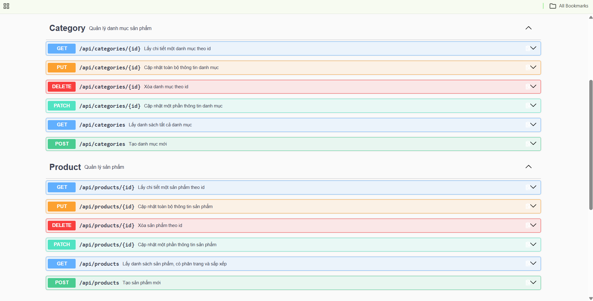

# E-commerce API

REST API quản lý sản phẩm và danh mục cho hệ thống bán hàng, xây dựng bằng Spring Boot. Dự án học tập và showcase backend Java.

## Tech stack

- Java 17
- Spring Boot 4.1.x (Spring Web MVC, Spring Data JPA, Bean Validation)
- MySQL 8
- Maven
- springdoc-openapi (Swagger UI)

## Chạy dự án

Yêu cầu: JDK 17, MySQL 8 đang chạy ở máy local.

1. Tạo file cấu hình từ file mẫu:

   ```bash
   cp src/main/resources/application.properties.example src/main/resources/application.properties
   ```

2. Mở `application.properties`, điền `spring.datasource.username` và `spring.datasource.password` của MySQL local. File này nằm trong `.gitignore`, không commit.

3. Chạy ứng dụng:

   ```bash
   ./mvnw spring-boot:run
   ```

4. Chạy test:

   ```bash
   ./mvnw test
   ```

Ứng dụng chạy tại `http://localhost:8080`.

## API documentation (Swagger)

Sau khi chạy ứng dụng:

- Swagger UI: <http://localhost:8080/swagger-ui.html>
- OpenAPI spec (JSON): <http://localhost:8080/v3/api-docs>



## Endpoint

| Method | Path | Mô tả |
|---|---|---|
| GET | `/api/products` | Danh sách sản phẩm, có phân trang và sắp xếp |
| GET | `/api/products/{id}` | Chi tiết một sản phẩm |
| POST | `/api/products` | Tạo sản phẩm |
| PUT | `/api/products/{id}` | Cập nhật toàn bộ sản phẩm |
| PATCH | `/api/products/{id}` | Cập nhật một phần sản phẩm |
| DELETE | `/api/products/{id}` | Xóa sản phẩm |
| GET | `/api/categories` | Danh sách danh mục |
| GET | `/api/categories/{id}` | Chi tiết một danh mục |
| POST | `/api/categories` | Tạo danh mục |
| PUT | `/api/categories/{id}` | Cập nhật toàn bộ danh mục |
| PATCH | `/api/categories/{id}` | Cập nhật một phần danh mục |
| DELETE | `/api/categories/{id}` | Xóa danh mục (không xóa được nếu còn sản phẩm) |

## Xử lý lỗi

Lỗi validation trả về `400` kèm danh sách lỗi theo từng field:

```json
{
  "errors": [
    { "field": "name", "message": "Name of category not blank" }
  ],
  "message": "Validation failed",
  "status": 400,
  "timestamp": "2026-10-11T18:12:41.3587938"
}
```

## Cấu trúc package

Base package `com.giahung19.ecommerce_api`:

- `rest/`: controller
- `service/`: interface và `*Impl`
- `repository/`: Spring Data JPA repository
- `entity/`: JPA entity
- `dto/`: request/response DTO
- `exception/`: custom exception và exception handler
- `config/`: cấu hình (OpenAPI)

## Trạng thái

Đang phát triển. Tiếp theo: bảo mật với Spring Security và JWT, tối ưu truy vấn JPA, Docker và CI.
